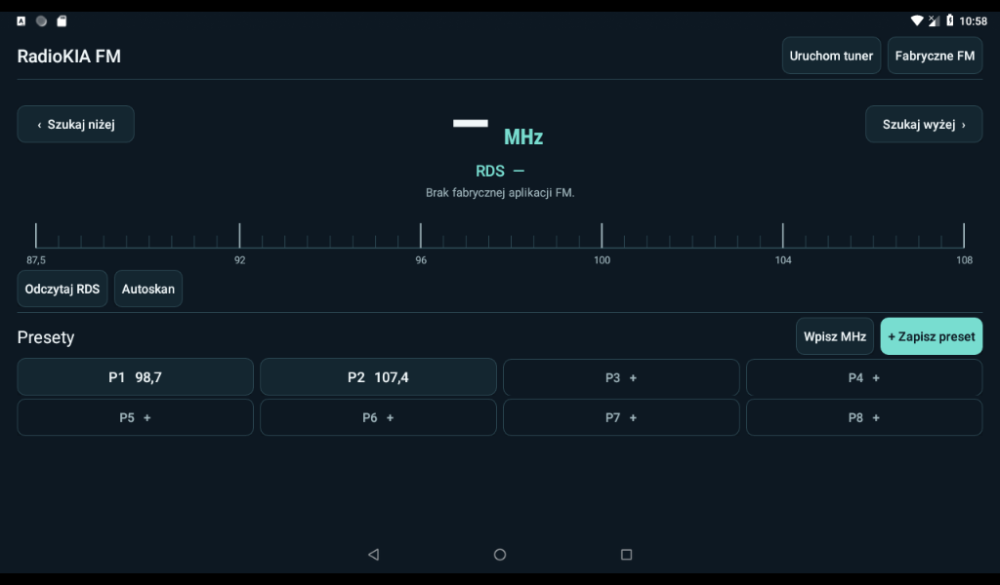
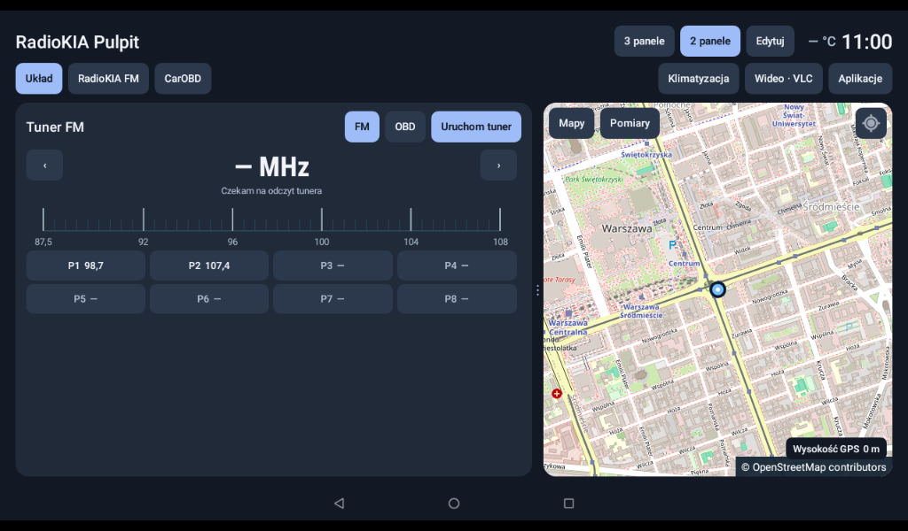
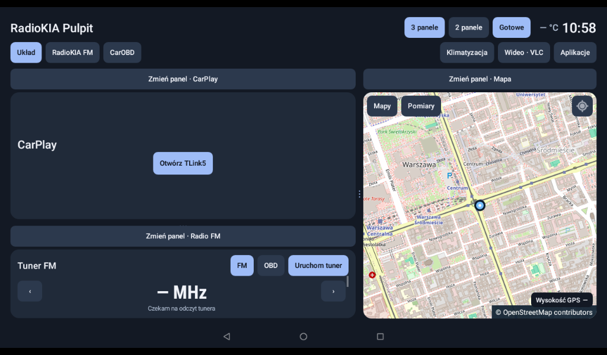

# RadioKIA

Tuner FM i konfigurowalny pulpit dla samochodowych stacji Android Topway. Projekt powstał na radiu TS7/TS18 w Kia Sorento. Pulpit pozwala mieć mapę i tuner obok siebie, a pełny ekran FM udostępnia strojenie, wyszukiwanie i osiem presetów.

## Pobieranie APK

| Aplikacja | APK | Co zawiera |
| --- | --- | --- |
| **RadioKIA FM 0.7.2** | [Pobierz APK](https://github.com/rysiulg/RadioKIA/releases/download/v0.7.2/RadioKIA_FM_v0.7.2.apk) | Pełny tuner z RDS, autoskanem i presetami P1–P8 |
| **RadioKIA Pulpit 0.3.31** | [Pobierz APK](https://github.com/rysiulg/RadioKIA/releases/download/v0.7.2/RadioKIA_Pulpit_Podglad_v0.3.31.apk) | Ekran z dwoma lub trzema panelami, kompaktowy tuner, mapa i CarOBD |

Oba APK są podpisane. Pliki i sumy SHA-256 są dostępne w [GitHub Releases](https://github.com/rysiulg/RadioKIA/releases/latest).

## RadioKIA FM

- Przeciągnij po skali, wpisz częstotliwość albo wyszukaj następną stację. Możesz zapisać osiem presetów.
- **Autoskan** pozwala wybrać wyniki do zapisania. Tryb **LOC** ogranicza skan do silniejszych sygnałów, a **DX** uwzględnia słabsze.
- **Odczytaj RDS** pobiera nazwę stacji, gdy udostępnia ją fabryczny tuner. RDS i autoskan korzystają z opcjonalnej usługi **RadioKIA FM** w Ułatwieniach dostępu.
- Na zgodnym TS7 krótkie naciśnięcie przycisku stacji na kierownicy zmienia preset, a przytrzymanie uruchamia wyszukiwanie.



## RadioKIA Pulpit

- Ustaw dwa lub trzy panele, zmień ich zawartość i przeciągnij uchwyty podziału. Zakładki **Układ**, **RadioKIA FM** i **CarOBD** działają także przez przesunięcie w bok.
- Kompaktowy tuner współdzieli presety z RadioKIA FM. Mapa pokazuje pozycję oraz wysokość, gdy GPS ją udostępnia oraz obsługuje gest dwoma palcami. Podkład mapy dostarcza [OpenStreetMap](https://www.openstreetmap.org/copyright).
- Opcjonalny [CarOBD Radio](https://github.com/rysiulg/carobd-radio) podaje dane aktywnego profilu. Pełny ekran zegarów i historia są dostępne po otwarciu CarOBD.
- Skróty do projekcji z telefonu otwierają zainstalowaną aplikację TLink5. Pulpit może też otwierać VLC lub DS video i odtwarzać bezpośredni strumień HTTPS we własnym oknie pływającym.
- Pulpit można ustawić jako ekran główny Androida. Opcja **Gesty motywu** dodaje przełączanie między ekranem producenta, RadioKIA FM i CarOBD.





Zrzuty pochodzą z emulatora Androida. Odczyt częstotliwości i RDS wymaga podłączonego, zgodnego tunera.

## Instalacja i zgodność

1. Pobierz APK na radio i otwórz je w menedżerze plików lub przeglądarce. Gdy Android o to poprosi, zezwól temu źródłu na instalację aplikacji.
2. Otwórz **RadioKIA FM** i wybierz **Uruchom tuner**, aby zainicjować fabryczne FM.
3. Zainstaluj **Pulpit**, jeśli chcesz używać kompaktowego tunera lub własnego układu. Dostęp do lokalizacji włącz, jeśli chcesz wyświetlać pozycję na mapie.

Do instalacji aplikacji wystarczy Android 8.1 (API 27) lub nowszy. Sterowanie radiem FM wymaga zgodnego oprogramowania Topway, usługi XTService oraz fabrycznej aplikacji FM. Działanie poszczególnych integracji zależy od modelu radia i wersji jego oprogramowania.

## Budowanie ze źródeł

Wymagane są Python 3.10+, JDK 17 lub nowszy, Android SDK z platformą `android-34` i Build Tools `35.0.0`. Uruchom z katalogu głównego repozytorium.

```sh
python fm-offline/build.py --sdk "ścieżka-do-Android-SDK"
python launcher-preview/build.py --sdk "ścieżka-do-Android-SDK"
```

Każdy skrypt tworzy podpisany APK w katalogu `dist` odpowiedniej aplikacji. Przy pierwszej kompilacji tworzy lokalną parę plików podpisu w `private`. Zachowaj ją do podpisywania następnych wersji. Opcja `--keys` wskazuje istniejący katalog podpisu. Do aktualizacji zainstalowanego APK Android wymaga podpisu tym samym kluczem.
